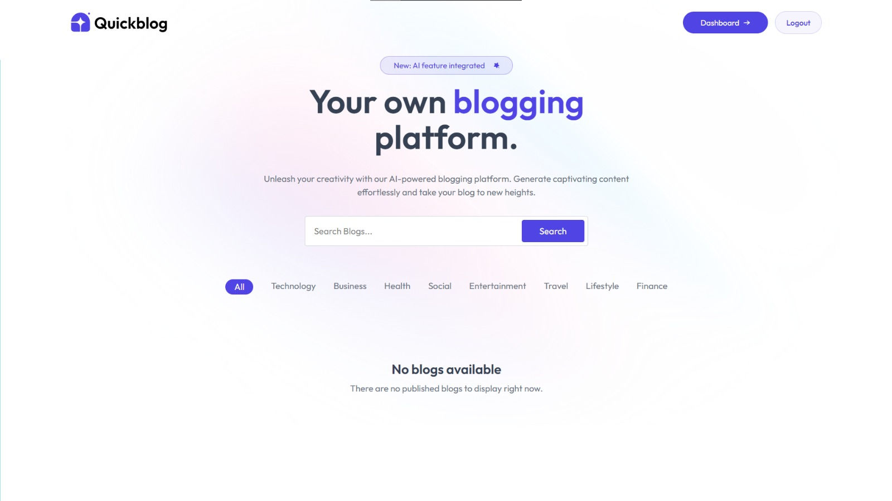
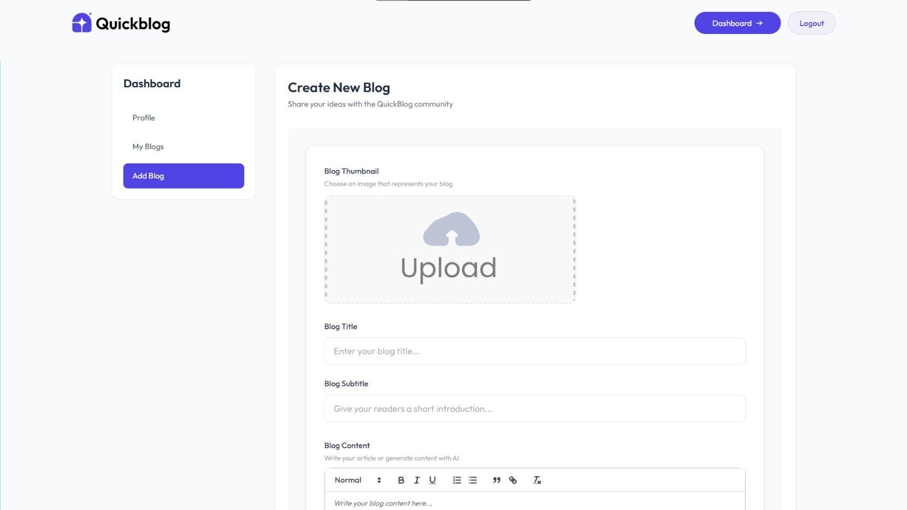
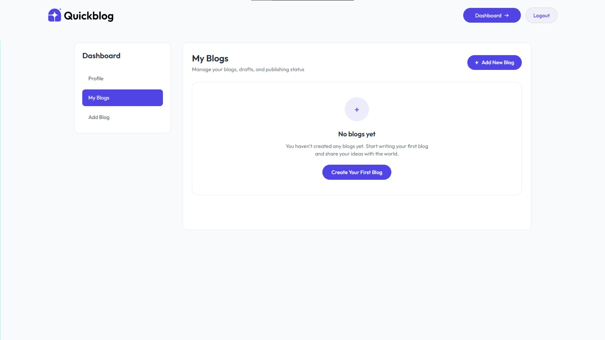
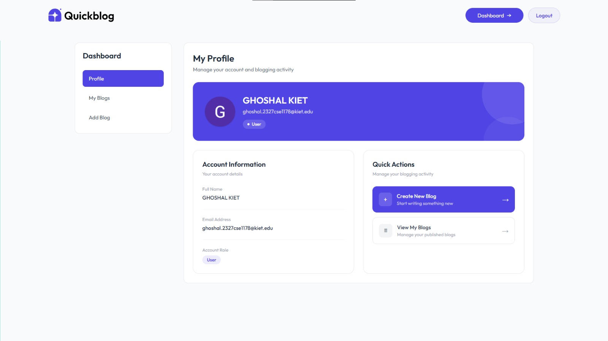
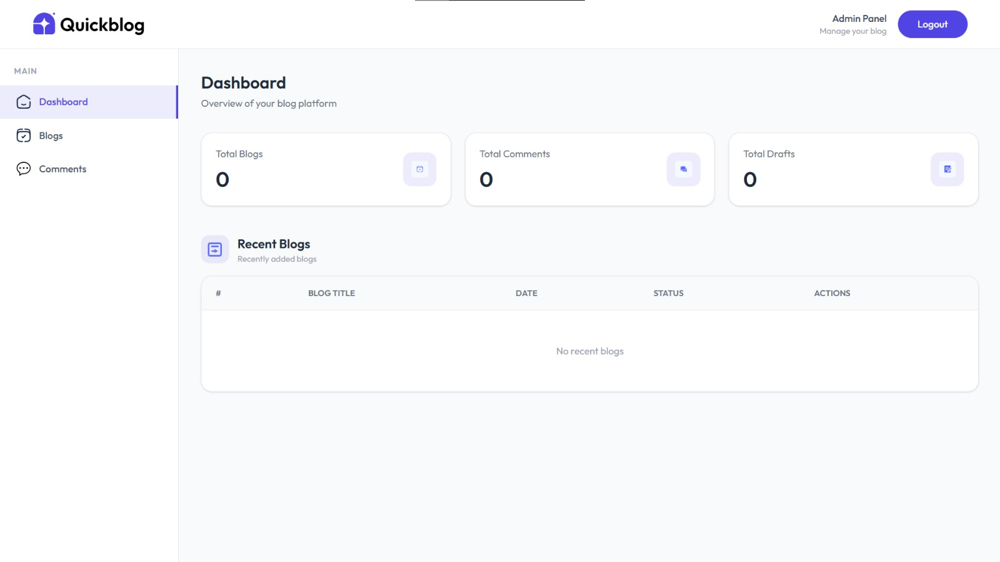

# QuickBlog — AI-Powered Blogging Platform

QuickBlog is a full-stack blogging platform built with the MERN stack. It supports blog publishing, AI-assisted content generation, user authentication, comment moderation, and an admin dashboard. Redis caching and BullMQ background workers handle frequently requested data and time-consuming tasks.

## Features

### Blogging and content management

- Create, edit, delete, and manage blog posts.
- Save posts as drafts or publish them.
- Write content with the Quill rich-text editor.
- Upload and optimize blog images with ImageKit.
- Organize posts by category.
- View published posts and manage personal posts from the user dashboard.

### AI-assisted writing

- Generate blog content using the Groq API.
- Process AI-generation requests asynchronously with BullMQ.
- Poll a job-status endpoint while content is being generated.
- Cache generated content in Redis using a hash of the prompt.

### Authentication and account management

- Email/password registration and login.
- Google OAuth sign-in.
- Email OTP verification during registration.
- OTP-based password recovery and email-change verification.
- JWT authentication stored in an HTTP-only cookie.
- Protected user and admin routes.
- Profile editing, including profile-image uploads.

### Comments and administration

- Users can add, edit, and delete their comments.
- New comments require admin approval before appearing on a blog.
- Admin dashboard with blog, comment, and platform statistics.
- Admin tools for managing blog posts and moderating comments.

### Performance and reliability

- Redis caching for the public blog feed, individual blog pages, user blog lists, and admin data.
- Cache invalidation in the main blog and comment management flows.
- Separate BullMQ queues and worker processes for AI generation and email delivery.
- Retry and backoff settings for background jobs.
- Redis-backed rate limits for general API requests, authentication, OTP requests, and AI generation.
- Zod validation for user, blog, and comment request data.
- Liveness and readiness endpoints for service checks.

## Tech Stack

| Layer | Technologies |
| --- | --- |
| Frontend | React 19, Vite 8, React Router 7, Redux Toolkit, Tailwind CSS 4, Quill, Motion |
| Backend | Node.js, Express 5, Mongoose, Multer, JWT, Zod |
| Data and jobs | MongoDB, Redis, ioredis, BullMQ |
| Integrations | ImageKit, Groq, Resend, Google OAuth |
| Tooling | npm, ESLint, Nodemon, k6 (optional load testing) |

## Project Structure

```text
QuickBlog/
├── client/
│   ├── public/                 # Static files and icons
│   └── src/
│       ├── api/                # Axios API client
│       ├── assets/             # Images, icons, and shared assets
│       ├── components/         # Shared, user, and admin components
│       ├── context/            # Theme context
│       ├── layout/             # Main, user, and admin layouts
│       ├── pages/              # Public, authentication, user, and admin pages
│       ├── redux/              # Redux slices and store
│       └── routes/             # Protected route guards
├── server/
│   ├── configs/                # MongoDB, Redis, and provider clients
│   ├── controllers/            # API request handlers
│   ├── middlewares/            # Authentication, uploads, rate limits, validation
│   ├── models/                 # Mongoose models
│   ├── queues/                 # BullMQ queue definitions
│   ├── routes/                 # User, blog, and admin routes
│   ├── services/               # Authentication, OTP, and email services
│   ├── utils/                  # Redis cache helpers
│   ├── validators/             # Zod request schemas
│   ├── workers/                # AI and email workers
│   ├── app.js                  # Express application and middleware
│   ├── server.js               # API server entry point
│   └── quickblog_new_benchmark.js # k6 load-test script
├── docs/
│   └── screenshots/            # Application screenshots
└── README.md
```

## Getting Started

### Prerequisites

- Node.js **20.19+ in the 20.x line**, or **22.12+** (Vite 8 requirement)
- npm
- MongoDB (local installation or MongoDB Atlas)
- Redis (local installation or hosted Redis)
- Docker Desktop, if you prefer to run Redis with Docker

To enable all integrations, also configure credentials for ImageKit, Groq, Resend, and Google OAuth. These provider credentials are only needed for the features that use those services.

### 1. Clone the repository

```bash
git clone https://github.com/Ghoshal12345/QuickBlog--AI-Powered-Blogging-Platform.git
cd QuickBlog--AI-Powered-Blogging-Platform
```

### 2. Install dependencies

Install the backend and frontend dependencies in their respective directories:

```bash
cd server
npm ci
```

```bash
cd ../client
npm ci
```

### 3. Start Redis

QuickBlog uses Redis for caching, rate limiting, and BullMQ queues. One way to run it locally with Docker is:

```bash
docker run --name quickblog-redis -p 6379:6379 -d redis:7-alpine
```

If the container already exists, start it with `docker start quickblog-redis`. Make sure MongoDB is also running or that your Atlas connection string is available.

### 4. Configure environment variables

Create `server/.env` from `server/.env.example` and provide the appropriate values:

```env
PORT=8000
NODE_ENV=development
CLIENT_URL=http://localhost:5173
MONGO_URI=mongodb://127.0.0.1:27017/quickblog
JWT_SECRET_KEY=replace_with_a_long_random_secret
IMAGEKIT_PRIVATE_KEY=your_imagekit_private_key
GROQ_API_KEY=your_groq_api_key
RESEND_API_KEY=your_resend_api_key
GOOGLE_CLIENT_ID=your_google_client_id
REDIS_URL=redis://localhost:6379
```

For MongoDB Atlas, use your Atlas connection string for `MONGO_URI`. Generate a strong, unique value for `JWT_SECRET_KEY`. Keep all real credentials in your local `.env` files; do not commit them.

Create `client/.env` from `client/.env.example`:

```env
VITE_BASE_URL=http://localhost:8000
VITE_GOOGLE_CLIENT_ID=your_google_client_id
```

The Google client ID configured in the frontend and backend should belong to the same Google OAuth application. Values with the `VITE_` prefix are exposed in the browser bundle, so never put private keys or secrets in frontend environment variables.

### 5. Run the application

Run each process in a separate terminal. Start MongoDB and Redis first.

**Terminal 1 — Express API**

```bash
cd server
npm run dev
```

**Terminal 2 — AI worker**

```bash
cd server
npm run worker:ai
```

**Terminal 3 — Email worker**

```bash
cd server
npm run worker:email
```

**Terminal 4 — React frontend**

```bash
cd client
npm run dev
```

The frontend is available at `http://localhost:5173` and the API uses `http://localhost:8000` by default.

### Health endpoints

| Endpoint | Purpose |
| --- | --- |
| `/health/live` | Confirms that the API process is running. |
| `/health/ready` | Checks MongoDB and the API's Redis connections. |

The readiness endpoint does not check whether the separate BullMQ worker processes are running. Start both workers for AI generation and background email delivery.

## Available Scripts

### Client (`client/`)

| Command | Description |
| --- | --- |
| `npm run dev` | Start the Vite development server. |
| `npm run build` | Create a production frontend build. |
| `npm run preview` | Preview the production build locally. |
| `npm run lint` | Run ESLint on the frontend. |

### Server (`server/`)

| Command | Description |
| --- | --- |
| `npm run dev` | Start the API with Nodemon. |
| `npm start` | Start the API with Node.js. |
| `npm run worker:ai` | Start the AI-generation worker. |
| `npm run worker:email` | Start the email-delivery worker. |

## Main Frontend Routes

| Route | Purpose |
| --- | --- |
| `/` | Public home page and blog feed |
| `/blog/:id` | Read a published blog |
| `/signup` | Create an account |
| `/login` | Sign in with email/password or Google |
| `/forgot-password` | Recover an account password |
| `/user/profile` | View the signed-in user's profile |
| `/user/edit-profile` | Edit profile details and image |
| `/user/my-blogs` | Manage personal blog posts |
| `/user/add-blog` | Create a blog post |
| `/user/edit-blog/:id` | Edit a personal blog post |
| `/admin` | Admin dashboard |
| `/admin/blogs` | Admin blog management |
| `/admin/comments` | Comment moderation |

The backend API is grouped under `/api/user`, `/api/blog`, and `/api/admin`.

> **Admin setup:** New accounts receive the `user` role by default. This repository does not currently include an admin-account seed script. Promote a trusted account to the `admin` role in your development database before testing the admin dashboard. Do not expose database access or use a default admin password in a public deployment.

## Performance Benchmarking (Optional)

The repository includes a k6 script at `server/quickblog_new_benchmark.js` for load testing the public blog-feed endpoint. With k6 installed and the API running, execute this from the repository root:

```bash
k6 run -e URL=http://localhost:8000/api/blog/all server/quickblog_new_benchmark.js
```

The explicit `URL` value is important because the script's fallback URL uses port `8006`, while the API defaults to port `8000`.

## Screenshots

### Home page



### Blog author workspace





### Profile



### Admin dashboard



## Security Notes

- Keep MongoDB credentials, JWT secrets, ImageKit private keys, Groq keys, and Resend keys on the server only.
- Do not commit `.env` files. The example environment files contain placeholders only.
- Use HTTPS and production-appropriate cookie settings when deploying.
- Restrict access to your Redis instance; the queues may contain email and job data.

## Contributing

1. Create a feature branch.
2. Make focused changes and run the available lint/build checks.
3. Include a clear description and screenshots for user-interface changes.

## License

No `LICENSE` file is currently included. Add a license if you intend to grant others explicit permission to use, modify, or distribute this project.
